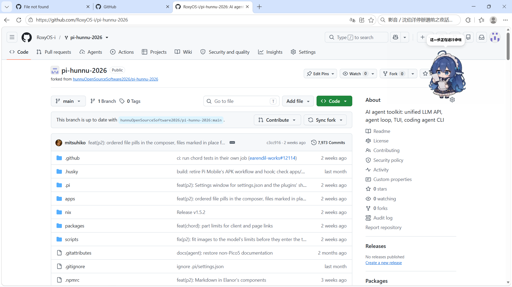
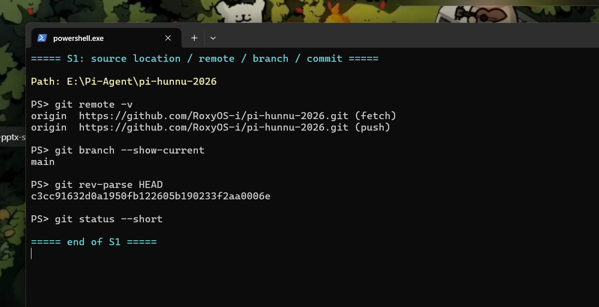
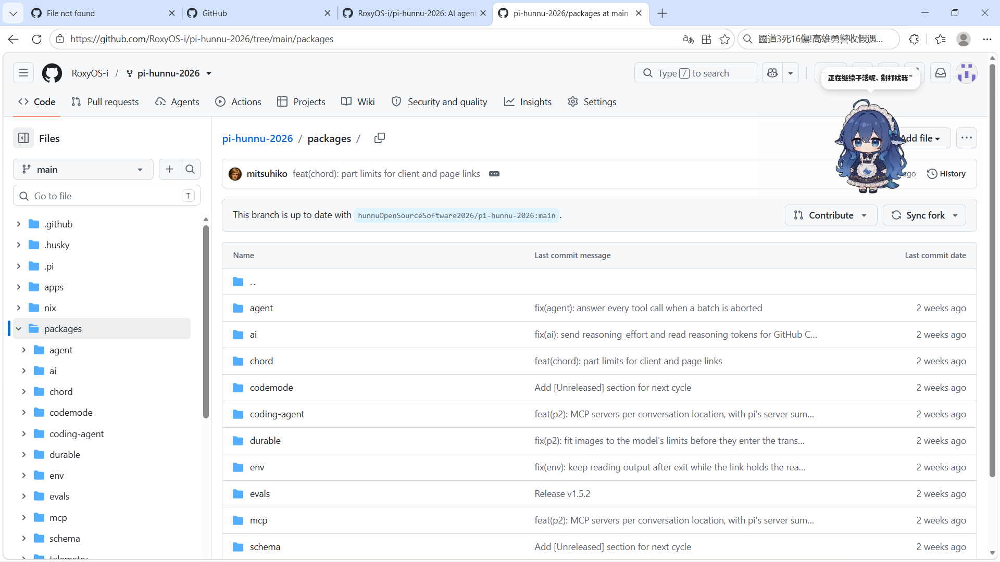
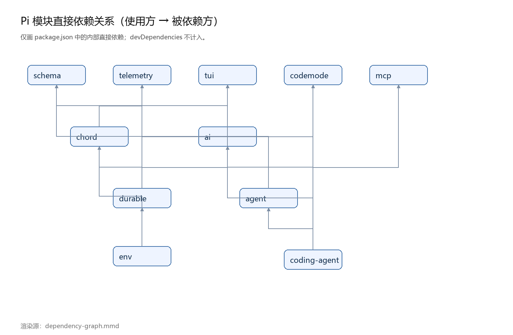

# 实践课 2：小组组织建仓与 Pi Agent 源码阅读

- 姓名：马轩
- 班级：软件一班
- 学号：202430224041
- 小组组织：RoxyOS-i
- 小组仓库：https://github.com/RoxyOS-i/pi-hunnu-2026
- 个人报告仓库：https://github.com/RoxyMax1173/pi-agent-assignment-02

## 一、源码获取

小组 fork 已创建在 RoxyOS-i 组织下，仓库为 `pi-hunnu-2026`，默认分支 `main`，页面显示 “forked from hunnuOpenSourceSoftware2026/pi-hunnu-2026”。



本地源码位于 `E:\Pi-Agent\pi-hunnu-2026`，使用浅克隆获取：

```bash
git clone --depth 1 --branch main https://github.com/RoxyOS-i/pi-hunnu-2026.git
```

实际记录：

```text
Path: E:\Pi-Agent\pi-hunnu-2026
origin: https://github.com/RoxyOS-i/pi-hunnu-2026.git
branch: main
commit: c3cc91632d0a1950fb122605b190233f2aa0006e
git status --short: 无输出（工作区干净）
```



`packages/` 下的模块目录：



组织成员检查：RoxyOS-i 当前成员为 `RoxyMax1173`（admin）、`cr1206`、`zgypx228`；小组 fork 对该组织可见，后续成员可从组织仓库继续开发。

## 二、模块功能与构建分析

说明：下表只统计 `package.json` 的内部直接依赖，不把 `devDependencies`、外部 npm 包算作模块依赖。所有包的版本均为 1.5.2，均使用 TypeScript；除特别说明外，`npm run build` 都是读取本包 `tsconfig.build.json`（继承根目录 `tsconfig.base.json`），把 `src/` 编译到 `dist/`。

| 子文件夹 | 功能 | build 做什么、生成什么 | 直接依赖的内部模块 | 依据 |
|---|---|---|---|---|
| telemetry | 供应商无关的遥测契约、指标和渲染工具 | `tsc -p tsconfig.build.json`，`src` → `dist` | 无 | `packages/telemetry/package.json`、`src/{index,metrics,render}.ts` |
| schema | JSON Schema 构建与校验；把 schema 编译成普通闭包，避免 eval | `tsc -p tsconfig.build.json`，`src` → `dist`；bench 单独运行 | 无 | `packages/schema/package.json`、`src/{compiler,builders,checks}.ts` |
| chord | 跨进程对象运行时：契约、文档、store、link、插件热重载、HTTP/worker/web/terminal 客户端 | `tsc`，`src` → `dist` | schema、telemetry | `packages/chord/package.json`、`src/{contracts,documents,link,host}` |
| tui | 终端 UI 库：差分渲染、同步输出、组件、编辑器、布局 | `tsc`，`src` → `dist`；原生模块另用 `build:native:*` | 无 | `packages/tui/package.json`、`src/{components,editor-component,layout-node}.ts` |
| codemode | 在 QuickJS（WASM）沙箱中执行模型生成的 JavaScript，只允许调用注入的工具 | `tsc`，`src` → `dist` | 无 | `packages/codemode/package.json`、`src/{runtime,wasm.ts}` |
| mcp | 独立 Model Context Protocol 客户端：协议、传输、OAuth、测试工具 | `tsc`，`src` → `dist` | 无 | `packages/mcp/package.json`、`src/{client,transports,protocol}` |
| ai | 统一 LLM API：多 provider、认证、模型目录、token/成本统计、流式调用 | 先生成模型目录并检查模型数据，再 `tsc`，最后复制 provider data 到 `dist` | schema、telemetry | `packages/ai/package.json`、`src/{api,auth,providers}` |
| durable | 持久化会话、任务、文档运行时；harness、session、search、images | `tsc`，`src` → `dist` | telemetry、schema、chord、ai、codemode | `packages/durable/package.json`、`src/{session,documents,harness}` |
| env | 远程执行环境：通过 SSH 部署 daemon，提供 ExecutionEnv 客户端、终端、进程、watch | `tsc`，`src` → `dist`；daemon 另用 cargo | chord、durable | `packages/env/package.json`、`src/{remote-env,ssh,process,terminal}.ts` |
| agent | 有状态 agent：agent loop、工具执行、事件流、transport 抽象、附件 | `tsc`，`src` → `dist` | ai、schema | `packages/agent/package.json`、`src/{agent-loop,agent,stream-fn}.ts` |
| coding-agent | 编码 agent CLI：read/bash/edit/write 工具、会话、交互/RPC 模式、扩展、打包入口 `pi` | 先 `tsc` 生成 unbundled dist，再用脚本打包 `dist/bundle/cli.js` | agent、ai、codemode、mcp、tui | `packages/coding-agent/package.json`、`src/{cli,core,modes,extensions}` |

### 依赖关系图



可编辑 Mermaid 源文件：[dependency-graph.mmd](dependency-graph.mmd)。

图中箭头统一为“使用方 → 被依赖方”，只包含内部直接依赖；外部依赖和 `devDependencies` 没有画入。层级划分依据是运行时职责：底层契约/基础设施（schema、telemetry、tui、codemode、mcp）→ 对象与模型层（chord、ai）→ 持久化与 agent 层（durable、agent）→ 远程环境（env）→ 最终 CLI（coding-agent）。

## 三、三个问题

### 1. 根目录与子模块中的 `npm run build` 分别读取什么配置、执行什么工作？

根目录读取 `package.json` 的 `scripts.build`。它没有使用 npm workspace 的自动拓扑构建，而是用 `cd packages/... && npm run build` 手工串行执行 11 个包：

```text
telemetry → schema → chord → tui → codemode → mcp → ai → durable → env → agent → coding-agent
```

根目录的 `tsconfig.json`/`tsconfig.base.json` 提供共享编译选项，但具体编译由各子包的 `tsconfig.build.json` 决定。

子模块读取自己的 `package.json`，执行 `tsc -p tsconfig.build.json`，该配置 `extends ../../tsconfig.base.json`，设置 `outDir: ./dist`、`rootDir: ./src`，把源码编译为 JS 和 `.d.ts`。特殊点：

- `ai` 的 build 还会先生成模型目录、检查模型数据，并在编译后复制 provider 数据；
- `coding-agent` 在 `tsc` 之后还会运行打包脚本，生成 `dist/bundle/cli.js`（`bin.pi`）；
- `tui`/`env` 的 native/daemon 构建是独立脚本，不在默认 `npm run build` 里；
- `durable` 的测试包含多套 store/worker 测试，但 build 本身仍是 `tsc`。

### 2. 构建顺序和模块依赖有什么关系？相邻构建的模块是否一定互相依赖？

构建顺序总体遵循“被依赖者先构建”：

```text
schema、telemetry → chord、ai → durable、agent → env、coding-agent
```

但不是严格拓扑排序，也不是相邻就一定依赖。例如：

- `chord` 在 `schema`、`telemetry` 之后，确实依赖二者；
- `tui` 紧挨 `chord` 构建，但 `tui` 不依赖 `chord`；
- `env` 在 `agent` 之前构建，但 `env` 不依赖 `agent`，`agent` 也不依赖 `env`；
- `coding-agent` 最后构建，依赖 `agent/ai/codemode/mcp/tui`，因此必须等这些包先产出 `dist`。

所以顺序是“依赖约束 + 手工排布”的结果，不能把相邻当成依赖证据。

### 3. 选择一条至少三个模块的依赖路径，说明分工

选择：

```text
coding-agent → agent → ai → schema
```

- `coding-agent`：面向用户的 CLI/会话层，负责 read/bash/edit/write 工具、交互模式、RPC、扩展加载和最终打包；它把任务交给 agent，把终端渲染交给 tui，把沙箱代码执行交给 codemode，把 MCP 工具交给 mcp。
- `agent`：agent 编排层，负责 agent loop、工具调用、事件流和状态管理；它调用 `ai` 获取模型输出，并用 `schema` 校验工具/消息结构。
- `ai`：模型接入层，统一不同 provider 的认证、模型目录、流式 API、token/成本统计；它依赖 `schema` 做结构校验，依赖 `telemetry` 上报指标。
- `schema`：最底层契约层，把 JSON Schema 编译成闭包并校验数据，不依赖其他内部模块。

这条路径体现了“用户接口/编排 → 模型访问 → 数据契约”的分层：上层负责流程和交互，中层负责模型调用，底层负责可复用的校验能力。

## 四、本人重点分析模块

本人重点分析 `coding-agent`、`agent`、`ai` 三个模块，重点看它们如何把 CLI、agent loop 和 provider API 串起来；`schema` 与 `telemetry` 作为被复用的底层契约一起阅读。

## 五、提交信息

- 小组仓库：https://github.com/RoxyOS-i/pi-hunnu-2026
- 个人报告：https://github.com/RoxyMax1173/pi-agent-assignment-02
- 报告文件：`REPORT.md`
- 依赖图源：`dependency-graph.mmd`
- 课程作业 Issue：待报告审核后再提交


